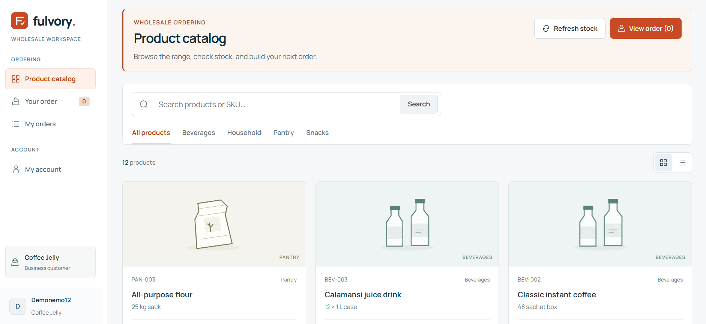
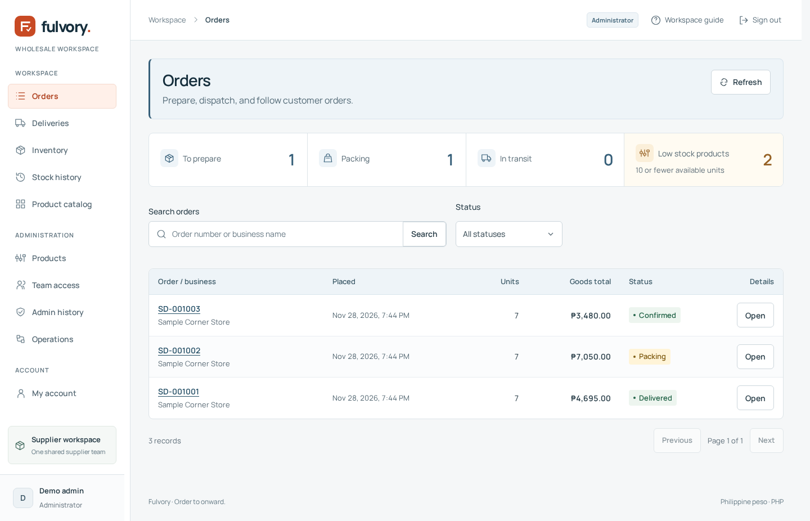
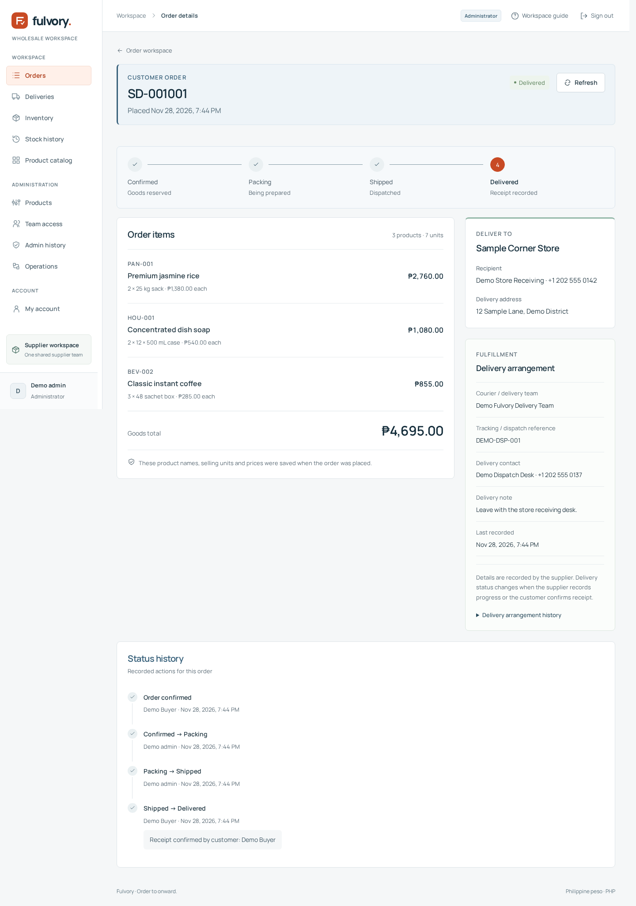
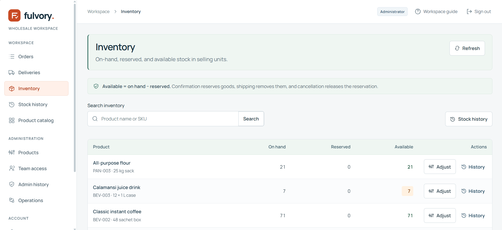

# Fulvory

## B2B Order Processing & Fulfillment Platform

Fulvory is a full-stack application that brings wholesale ordering, stock control, supplier operations, and delivery records into one shared workspace.

It is designed for **one supplier, one warehouse, and multiple customer businesses**. Customers place and follow their orders, staff handle daily fulfillment, and administrators manage products and team access.

**Java 21 · Spring Boot · Spring Security · React · PostgreSQL · Docker · GitHub Actions**

## Demo Video

### [Watch the Fulvory walkthrough on YouTube](YOUTUBE_VIDEO_URL)

The walkthrough follows a customer order from product selection through supplier preparation, dispatch recording, and confirmation of receipt. It also introduces inventory management and supplier team permissions.

## The Problem Fulvory Addresses

A wholesaler handling orders through separate chat messages and spreadsheets can struggle to keep product prices, available stock, order progress, and delivery arrangements consistent.

Fulvory brings those records together and adds business rules for situations such as:

- Two customers trying to order the same remaining stock.
- A customer retrying checkout after an interrupted request.
- Catalog prices changing while an order is being reviewed.
- Staff submitting a stock count based on an outdated screen.
- Administrators changing a team member's access.
- Customers needing an explanation of their order's progress.

The application connects the customer-facing catalog to supplier operations while retaining a history of significant actions.

## User Roles and Shared Data

| Role | How the account is created | Main responsibilities |
|---|---|---|
| Customer | Public registration creates a customer business and its first account. | Browse products, place orders, view their business's orders, cancel eligible orders, and confirm receipt. |
| Staff | An administrator adds an individual supplier team member. | Prepare customer orders, record delivery arrangements, maintain stock counts, and review stock history. |
| Administrator | Initial administrator provisioning, then controlled team administration. | Staff capabilities plus product administration, team access management, and administrative monitoring. |

Administrators and staff work with **the same supplier's products, inventory, and orders**. Adding another administrator gives another person access to that shared operation.

Customer order access is scoped to the authenticated customer business.

## Main Application Modules

| Module | Functionality |
|---|---|
| Product catalog | Search and filter products, inspect selling units and prices, and see stock availability. |
| Product administration | Create, edit, and deactivate products; manage unique SKUs and optional product photos. |
| Cart and checkout | Build an order, request a current server-calculated quote, and submit delivery information. |
| Customer orders | Review order items, totals, progress, and delivery details; perform permitted cancellation and receipt actions. |
| Supplier orders | Review the shared order queue and move eligible orders through packing, shipment, and delivery. |
| Inventory | View on-hand, reserved, and available quantities; record physical stock counts with reasons. |
| Stock history | Review stock changes, quantities, resulting balances, actors, reasons, and related orders. |
| Deliveries | Record an independently arranged courier or rider, business contact, dispatch reference, and customer-visible notes. |
| Team access | Add individual staff or administrator accounts, change roles, and enable or disable access with a recorded reason. |
| Account security | Email verification, password recovery, authenticated password changes, and supplier account setup. |
| Operations and history | Review mail queue state, delivery mode, account security events, and administrative changes. |

## Customer-to-Supplier Workflow

1. **Browse and review.** A customer selects products and quantities, then reviews a quote calculated from current database prices.
2. **Confirm the order.** The backend rechecks prices and stock, saves the order's item and price snapshots, and reserves the required quantities in one transaction.
3. **Prepare the goods.** The supplier team opens the order and starts packing.
4. **Record the delivery arrangement.** Staff independently arrange a courier or rider and save the relevant delivery details.
5. **Record shipment.** After the goods are handed over, staff mark the order Shipped. Its quantities are deducted from both on-hand and reserved stock.
6. **Confirm receipt.** The owning customer confirms arrival, or authorized staff record delivery confirmation with an explanation.
7. **Review the history.** Order progress and related stock changes remain available for review.

### Order Lifecycle

~~~mermaid
stateDiagram-v2
    CONFIRMED --> PACKING: Start packing
    PACKING --> SHIPPED: Record handover
    SHIPPED --> DELIVERED: Confirm receipt
    CONFIRMED --> CANCELLED: Eligible cancellation
    PACKING --> CANCELLED: Eligible cancellation
~~~

Cancellation releases reserved stock. Shipped and delivered orders cannot be cancelled through this workflow.

Recording a courier arrangement alone does not deduct stock or contact a delivery provider.

## Backend Engineering Highlights

### Atomic Stock Reservations

Order confirmation locks the selected product and inventory rows in PostgreSQL, checks availability, and reserves all requested items within the order transaction.

A failure rolls back the order and its stock changes together.

Available stock is calculated as **on-hand minus reserved**. Database constraints protect the rule that reserved quantities cannot exceed on-hand stock.

### Safe Order Retries

Each order submission has a customer-business-scoped idempotency key.

Repeating an equivalent submission returns the original order. Using an existing key for a different request produces a conflict.

The browser retains the pending submission and its key through uncertain outcomes, allowing the customer to retry the same intent without creating another order or reserving stock again.

### Server-Controlled Pricing

The backend calculates quotes and final order amounts using Java BigDecimal and PostgreSQL NUMERIC values.

It rechecks the quote during confirmation and asks the customer to review a changed price.

Order lines retain product, SKU, selling-unit, and price snapshots. Later catalog edits do not rewrite the details of an existing order.

### Version Checks for Concurrent Edits

Stock counts, product changes, delivery records, and team access changes check the version or revision the user reviewed.

An outdated form is rejected instead of silently replacing a newer change.

A physical stock count must preserve existing reservations. Staff refresh and recount after a conflicting stock change.

### Controlled Fulfillment Transitions

The backend validates each status transition and applies related order, stock, and history changes in the same transaction.

Repeated requests for a previously recorded state do not repeat its stock effects or append duplicate status events.

Order and inventory locks use a consistent ordering to coordinate concurrent actions.

### Server-Side Authorization

Spring Security enforces role permissions. Customer order queries also check ownership using the authenticated business identity.

Supplier administration endpoints have separate access rules from customer ordering endpoints.

Public registration creates customer accounts. Privileged supplier access is managed through administrator workflows.

### Actor-Attributed History

Order status changes, stock movements, administration actions, delivery edits, and account security events record the relevant actor and time.

Protected history tables reject ordinary update and delete operations through database triggers.

This supports traceability when reviewing how an order, balance, or access setting changed.

## Account Security and Email Recovery

- Passwords are stored using BCrypt hashes.
- Cookie-based sessions use CSRF protection for state-changing requests.
- Verification and password setup/reset links are single-use, expire, and are tied to the account's access revision.
- Token records store digests; pending email token payloads are encrypted with AES-GCM.
- Password and access changes invalidate earlier sessions on subsequent authenticated requests.
- Team access changes protect the last enabled administrator.
- Persistent rate limits cover authentication and sensitive account actions.

Account actions and their queued email records are committed together. A background worker sends queued messages using SMTP with bounded timeouts and retries.

Mailpit provides local email capture during development. An external SMTP sender is configured separately for a hosted installation.

## Frontend Experience

The React interface provides customer and supplier workspaces with responsive navigation, searchable lists, status indicators, and explicit loading and error feedback.

- Loaded matching queries can remain visible during background refresh.
- Read caching is scoped to the signed-in workspace, with separate entries for filters and pages.
- Successful or uncertain writes invalidate affected reads without automatically replaying the write.
- Checkout still requests a fresh quote.
- Product photos use category artwork as a fallback when no photo is available.
- Optional JPEG/PNG uploads are validated and processed by the backend.

## Architecture and Technology

The backend uses a **feature-based modular monolith**.

Controllers handle HTTP requests, services own business rules and transactions, and repositories access PostgreSQL. API responses use DTOs.

| Area | Implementation |
|---|---|
| Backend language | Java 21 |
| Application framework | Spring Boot |
| Authentication and authorization | Spring Security, cookie sessions, role and ownership checks |
| Persistence | Spring Data JPA, targeted JDBC queries, PostgreSQL |
| Schema management | Flyway migrations |
| Frontend | React and Vite |
| Account email | SMTP with a durable database outbox |
| Local email testing | Mailpit |
| Build tooling | Maven and npm |
| Containers | Docker and Docker Compose |
| Automated workflow | GitHub Actions |

The prepared same-origin hosting image packages the React production build with Spring Boot.

PostgreSQL persists application records and product photos. The current session design uses one backend instance.

## Testing and Continuous Integration

The project's recorded verification evidence includes:

| Suite | Recorded passing tests | Examples of coverage |
|---|---:|---|
| Backend unit and PostgreSQL integration tests | 140 | Ordering, stock behavior, account lifecycle, permissions, product images, operations, and delivery records. |
| Frontend tests | 38 | Submission recovery, price formatting, API behavior, photo selection, and query-cache behavior. |
| Courier simulator tests | 7 | Stable booking references, temporary failures, timeouts after acceptance, and simulator restart recovery. |

These counts come from separate recorded verification stages: the backend and simulator evidence is from the business-pilot release, and the frontend evidence is from UI version 1.4.1.

The GitHub Actions workflow runs:

- Backend unit and integration tests.
- Frontend tests and a production build.
- Courier simulator tests.
- Docker image builds.
- Disposable application services and HTTP smoke checks.

Pushes and pull requests trigger the workflow, and a manual run is available.

The test suites provide repeatable checks of covered behavior. Manual workflow testing and verification in the actual hosting environment complement those checks.

## Screenshots

### Product Catalog

Customers browse the wholesale catalog with product prices, selling units, and stock indicators.

### Supplier Orders

Administrators and staff share the order queue and review fulfillment progress.

### Order Details and Delivery

The supplier team can review the ordered items, saved prices, and goods total alongside the recorded dispatch details. The delivery timeline and status history show how the order reached receipt confirmation.

### Inventory

The inventory workspace shows stock balances and supports reasoned physical count adjustments.

## Delivery Modes and Project Scope

### Manual Delivery

Manual delivery supports a supplier's own rider or a courier arranged independently.

Staff save the arrangement and report shipment. The customer or authorized staff then confirm delivery.

### Courier Simulation

Simulation mode is a separate testing path for booking success, failure, timeout, and retry scenarios.

It creates simulated references and saved attempts.

### Current Scope

The current release covers:

- One supplier.
- One warehouse.
- Multiple customer businesses.
- PHP goods totals.
- Whole product selling units.
- Customer, staff, and administrator accounts.
- Staff-recorded delivery arrangements and receipt confirmation.

Automatic real-courier booking, rider accounts, GPS tracking, online payments, tax invoicing, returns/refunds, and multi-supplier tenancy are outside this release.

Fulvory is presented here as a personal portfolio application.

Deployment configuration and operating guides are included in the private project. A live installation requires its own hosting, SMTP, persistence, and recovery checks.

## About This Repository

---

## 📁 Showcase Repository Structure

This public repository contains Fulvory's project documentation, screenshots, and a link to its demonstration video.

| Path | Description |
|---|---|
| README.md | Project overview, features, workflows, architecture, and demo link. |
| screenshots/catalog.png | Customer product catalog. |
| screenshots/supplier-orders.png | Supplier order management workspace. |
| screenshots/order-details.png | Delivered order details, dispatch record, and status history. |
| screenshots/inventory.png | Inventory management workspace. |
| .gitignore | Excludes local IDE settings and temporary files. |

### Source Code Availability

The complete Fulvory application source code is maintained in a separate private GitHub repository.

It includes:

- Java Spring Boot backend and REST APIs.
- React frontend built with Vite.
- PostgreSQL schema and Flyway database migrations.
- Authentication, authorization, and account recovery components.
- Order processing, stock reservation, and fulfillment logic.
- Delivery records, audit history, and courier simulation.
- Automated backend, frontend, and simulator tests.
- Docker configuration and GitHub Actions workflows.

**Source-code review or a technical walkthrough may be arranged upon request.**

---

## 🎯 Project Purpose

Fulvory is a personal portfolio project focused on strengthening practical skills in Java backend engineering and full-stack application development.

The project focuses on:

1. Designing RESTful APIs using Java and Spring Boot.
2. Organizing a modular monolith with clear controller, service, and repository responsibilities.
3. Implementing authentication, role-based authorization, and customer business ownership checks.
4. Managing relational data and schema migrations with PostgreSQL and Flyway.
5. Applying transactions, database locks, and constraints to protect inventory consistency.
6. Handling repeated order submissions safely through idempotency.
7. Building account verification, password recovery, and durable email processing.
8. Integrating React interfaces with Spring Boot REST services.
9. Recording significant business actions through audit and stock histories.
10. Practicing automated testing, debugging, container packaging, and continuous integration.

The application provides a practical setting for studying how business rules, security, data consistency, and failure recovery work together.

---

## 👨‍💻 Developer

**Bryan — Aspiring Java Backend Developer**

GitHub: [@IT-BRYYY](https://github.com/IT-BRYYY)

**Primary Technologies:** Java · Spring Boot · Spring Security · PostgreSQL · React · REST APIs

---

*Fulvory — Wholesale ordering, inventory control, and organized fulfillment.*